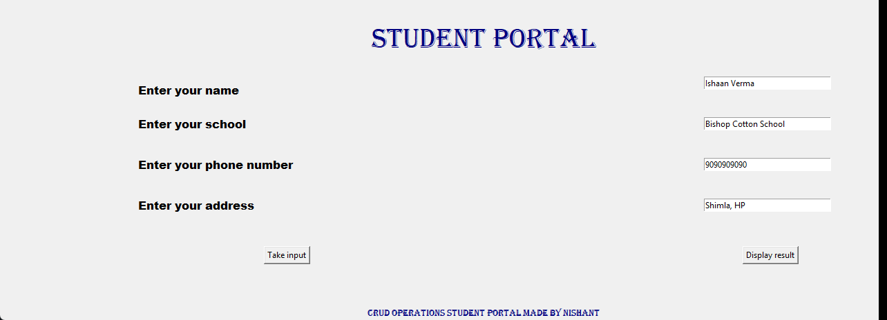
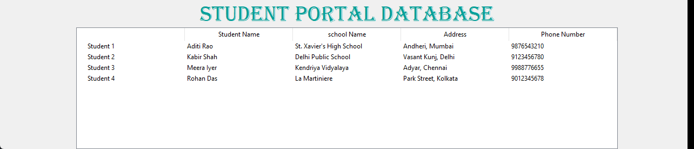

<div align="center">

# 🎓 Student Portal Database

### A desktop student register in ~130 lines of Python

**Type a student in, press a button, and they're saved to a real SQL database. Press another, and the whole register
appears in a table. A compact, readable introduction to GUIs + databases with nothing to install.**




</div>

---

## What it does

1. **Add** a student: name, school, phone number and address, saved with **Take input**.
2. **View** everyone: **Display result** opens a table of every record in the database.
3. Data lives in `management.db` (SQLite), created automatically next to the script, so it's still there next time.



## Run it

Python ships with both Tkinter and SQLite, so there is nothing to install:

```bash
python Github-1.py
```

## How it works

| Piece | What it does |
|---|---|
| `sqlite3.connect('management.db')` | Opens (or creates) the database file |
| `CREATE TABLE IF NOT EXISTS management_table` | Auto-increment ID, name, school, address, phone |
| `INSERT … VALUES (?, ?, ?, ?)` | Saves the form with placeholders, so names like *O'Brien* work and SQL injection can't |
| `ttk.Treeview` | Renders every row from `SELECT *` as a table |
| `tk.Label` / `tk.Entry` / `tk.Button` on a `grid` | The form layout |

## Make it yours

Good first contributions if you're learning: **edit** and **delete** buttons (the U and D of CRUD), a search box,
phone-number validation, or exporting the register to CSV.

---

<sub>One of my first projects (2022). Students in the screenshots are made-up sample data.</sub>
